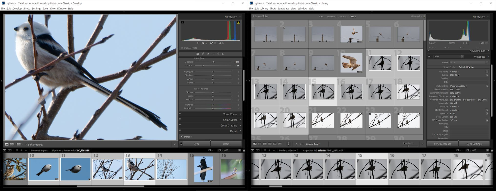
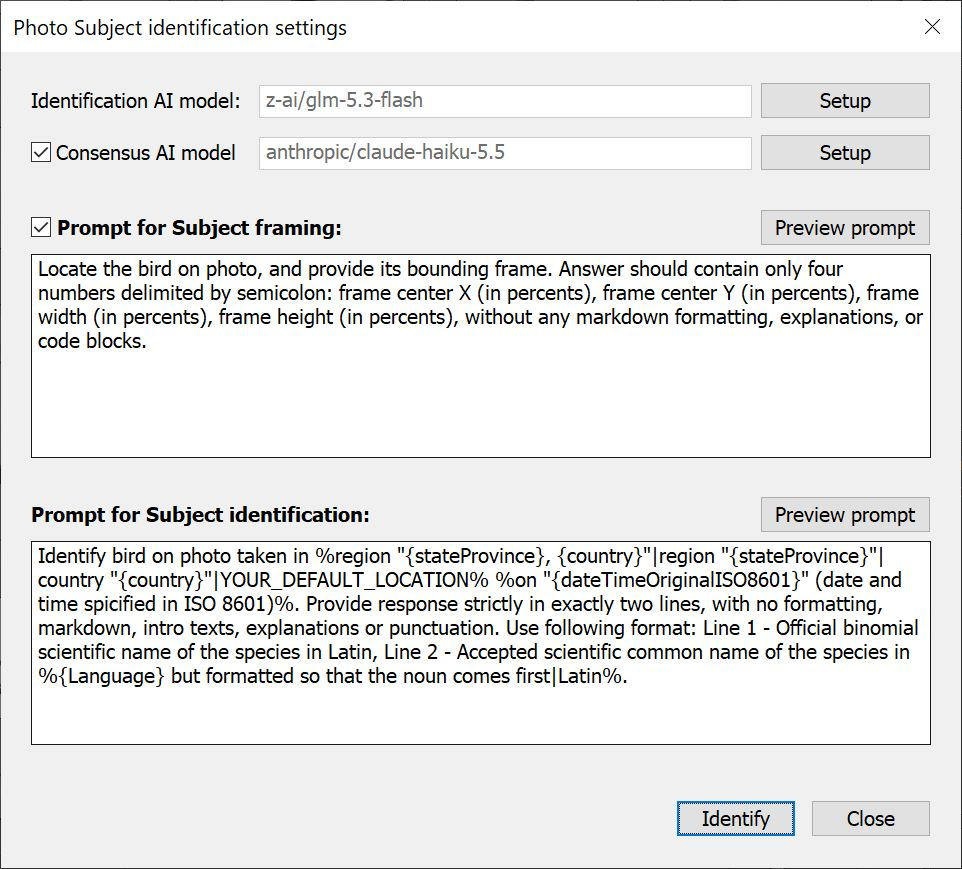
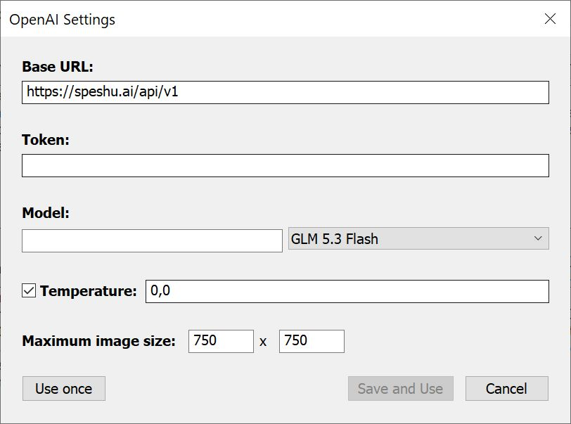
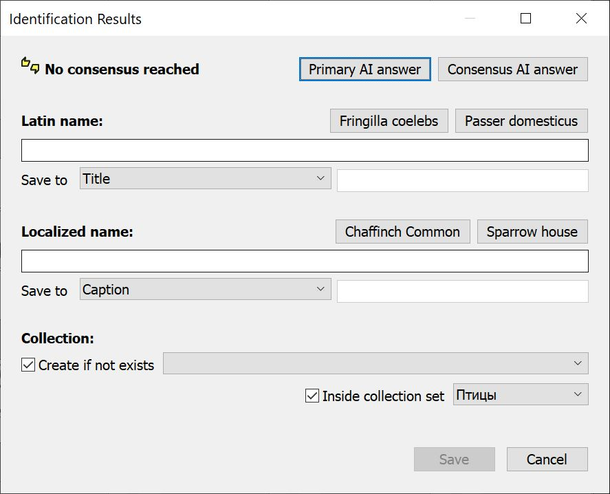
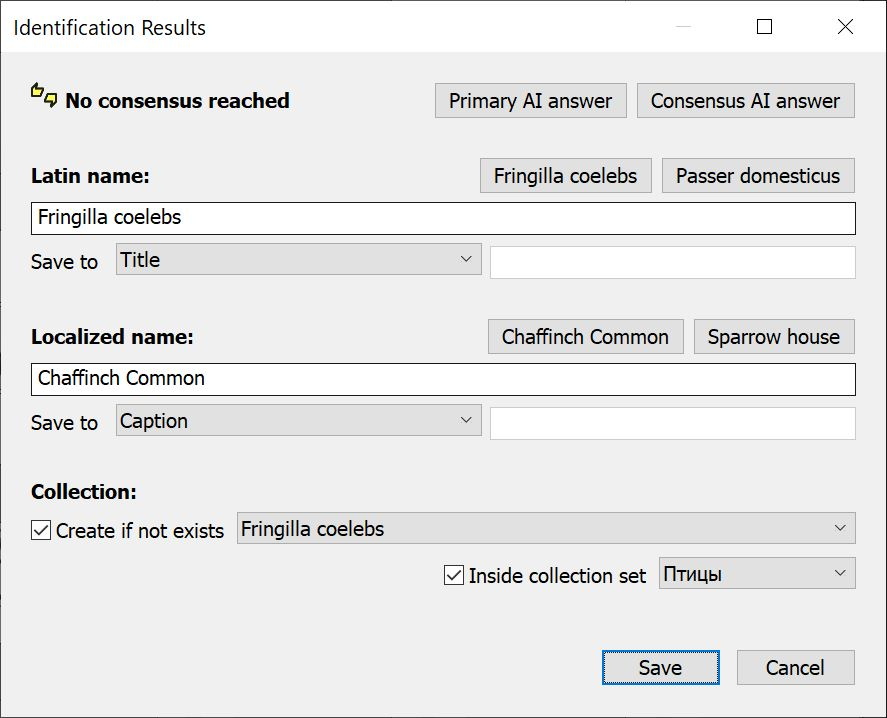

[English](README.md) | [Русский](README.ru.md) | [简体中文](README.zh-CN.md)

# AIWI — Adobe Lightroom Classic Plugin for AI-Powered Bird and Wildlife Identification

## Description

**AIWI** is a plugin for **Adobe Photoshop Lightroom Classic** designed to help wildlife and bird photographers automatically identify species captured in photos using multimodal AI vision models. The plugin writes identification results directly into the Lightroom catalog: photo metadata fields, keyword hierarchies, and dynamic (smart) collections.

Important note: **the plugin itself does not contain any built-in AI models**. All image recognition is performed by an **external AI service** accessible via an OpenAI-compatible API (by default `https://api.openai.com/v1`, though other compatible endpoints may be used). The plugin acts as a bridge:

- prepares and exports the photo (at a downscaled resolution) and constructs prompts with photo metadata;
- sends API requests to the selected AI service;
- parses model responses and validates results;
- writes structured taxonomy and metadata into the Lightroom catalog.

The plugin **does not provide AI services directly and is not responsible for their operation**: recognition quality, service availability, data privacy, and per-token API costs are governed by your agreement with your chosen AI provider. An active internet connection and an API token from your chosen provider are required.

## Key Features

AIWI eliminates the manual routine of bird and wildlife classification. Beyond basic species identification, the plugin implements three core features that ensure higher reliability, speed, and workflow convenience:

### Consensus Mode: Two Independent Models Instead of One

#### The Problem

When an identification request is sent to a single AI model, it returns a single answer — but there is no reliable way to gauge its accuracy. Vision models often identify species with high confidence even when wrong; they do not flag uncertainty. Photographers are left wondering whether to trust the output, cross-check manually with a second tool, or consult field guides. For rare, cryptic, or visually similar species, error rates can be significant.

#### How AIWI Solves This

AIWI implements an automated **consensus mode**: the same image and prompt are simultaneously submitted to a **second, independent AI model**. The responses from both models are compared, and the results dialog indicates the consensus status:

- **"Identified with consensus"** (🟢 Green) — both models agreed on the species. Two independent neural networks with different architectures arriving at the same identification provides substantially higher confidence than either model alone;
- **"No consensus reached"** (🟡 Yellow) — the models suggested different species. This transparently signals that human verification is needed. AIWI does not mask discrepancies, allowing you to review both responses and pick the correct option (or reject both).

Even when models disagree, consensus mode is informative: full responses from both models can be inspected, and the correct species is often apparent from the combination (for example, when both models agree on the genus).

#### Recommendation: Models from Different Providers

The highest accuracy is achieved by combining models from **different vendors** (e.g., OpenAI as the primary model and Anthropic or Google as the consensus model). Different vendors train on different datasets with distinct architectures and blind spots — errors rarely overlap. Conversely, models from the same vendor may share common biases. Each model’s connection parameters are configured independently.

Specific model recommendations are provided below in the [Recommended AI Models](#recommended-ai-models) section.

### Metadata Substitutions in Prompts: Contextual Hints Directly from Photo EXIF

#### The Problem

When an AI receives only an image, it must guess the shooting context. Yet that context often already exists in Lightroom metadata: shooting location, date, camera gear, and environmental conditions. A single clue like "photographed in Florida" is often enough for a model to distinguish between visually similar species, as geographic distribution immediately eliminates lookalikes from other continents. Capture date is similarly crucial for accounting for seasonal plumage, migration patterns, and breeding ranges.

#### How AIWI Solves This

Both prompts in AIWI (framing and identification) support **macro substitutions**: text fragments enclosed in `%…%` that the plugin dynamically replaces with metadata values from the **exact photo being analyzed**. You define prompt templates once, and they automatically adapt to each photograph.

Within a substitution block, you can specify **fallback variants separated by `|`**. AIWI selects the first variant for which all referenced metadata fields are non-empty. The last variant can be a **static fallback** — plain text without variables used if all preceding fields are blank.

##### Example 1: Location with a Static Fallback

```text
Identify the bird. Photographed in %city "{city}"|YOUR_DEFAULT_LOCATION%.
```

- if the photo has a valid `city` metadata tag (e.g., `Miami`), the prompt resolves to: `Identify the bird. Photographed in city "Miami".`
- if `city` is empty, the static fallback applies: `Identify the bird. Photographed in YOUR_DEFAULT_LOCATION.`

##### Example 2: Optional Date Insertion

```text
Identify the bird on the photograph%, taken on {date}%
```

- if capture date is present, the prompt becomes: `Identify the bird on the photograph, taken on May 12, 2025`
- if date is missing, the substitution block cleanly evaluates to empty text: `Identify the bird on the photograph`

The **"Preview prompt"** button in the setup dialog displays the resolved prompt with current photo metadata filled in before making any API requests.

### Automatic Framing and Auto-Tone: Rapid Culling of Fresh Wildlife Bursts

#### The Problem

A wildlife burst typically consists of dozens or hundreds of raw shots taken in rapid sequence: the subject is small in the frame, distant, and exposure is locked for action. In this unedited state, AI models struggle: subject details are lost across wide-angle frames, and underexposed or backlit shots obscure plumage patterns. Manually cropping, lifting shadows, and balancing tone on every frame before identification defeats the purpose of automation.

#### How AIWI Solves This

AIWI automates preparation **on the fly without altering your catalog originals**. When "Prompt for Subject framing" is enabled, the plugin executes an automated pre-processing sequence:

1. **Crop is temporarily cleared** — the model views the complete uncropped frame to locate the subject;
2. **Auto-Tone is temporarily applied** — equivalent to clicking "Auto" in Lightroom's Develop module, balancing exposure, highlights, and shadows so dark or backlit plumage becomes visible;
3. **The model returns bounding box coordinates**, and AIWI applies a tight crop around the subject with a **10% safety margin**;
4. **The cropped, tone-balanced close-up** is sent for species identification;
5. Upon completion (or cancellation), **all original photo Develop settings and crop parameters are automatically restored**.

Photographers can simply highlight a burst, select the sharpest frame, and launch AIWI. The plugin prepares the image, runs the identification, tags the whole series, and leaves the original RAW file untouched.

## Requirements for Installation and Operation

### Adobe Lightroom Classic Environment

| Parameter | Requirement | Notes |
| :--- | :--- | :--- |
| **Application** | Adobe Lightroom Classic | Cloud-based Lightroom (CC / Mobile) is **not supported** due to lack of Classic SDK support. |
| **Minimum SDK Version** | **Lightroom SDK 10.0** | Corresponds to **Adobe Lightroom Classic 10.0** (October 2020) and newer. |
| **Recommended Version** | **Lightroom Classic 13.2+** | Starting with version 13.2 (SDK 13.2), accessibility fields `Alt Text` and `Extended Description` are supported. Earlier versions support `Title`, `Caption`, custom fields, keywords, and collections. |
| **Operating System** | Windows 10/11 (64-bit) or macOS | Any operating system officially supported by your Lightroom Classic version. |
| **File System** | Write permissions for temporary folder | The plugin exports downscaled temporary JPEGs to the system `temp` directory and cleans them up automatically. |

### API Requirements for AI Providers

The plugin does not contain built-in models and connects to external or local AI models over HTTP.

**Protocol and Format:**
* **API Standard:** Fully compatible with the **OpenAI Chat Completions API** specification (`POST /chat/completions`, `GET /models`).
* **Multimodal / Vision Support:** The target model must support image inputs (images are submitted as Base64 Data URLs).

### Supported AI Providers and Model Aggregators

Thanks to customizable `Base URL` support, AIWI works with any OpenAI-compatible provider:

#### AI Aggregators and Cloud Providers

| Provider | Base URL | Features |
| :--- | :--- | :--- |
| [**OpenAI**](https://platform.openai.com/) | `https://api.openai.com/v1` | Industry-standard recognition accuracy for biological taxonomy, flora, and fauna. |
| [**CometAPI**](https://cometapi.com/pricing/) | `https://api.cometapi.com/v1` | Unified aggregator: single API key for 500+ models (OpenAI, Anthropic, Google) with discounted rates and failover routing. |
| [**OpenRouter**](https://openrouter.ai/) | `https://openrouter.ai/api/v1` | Multi-provider hub: access top models across all major vendors via one balance. Ideal for consensus mode. |
| [**Google Gemini**](https://aistudio.google.com/) *(OpenAI endpoint)* | `https://generativelanguage.googleapis.com/v1beta/openai/` | Fast response times and high accuracy in complex visual scenes. |
| [**Groq**](https://console.groq.com/) | `https://api.groq.com/openai/v1` | Ultra-fast inference speeds on LPU hardware. |
| [**Mistral AI**](https://console.mistral.ai/) | `https://api.mistral.ai/v1` | Dedicated multimodal European models (`pixtral-12b`, `pixtral-large`). |
| [**Zhipu AI (GLM)**](https://bigmodel.cn/) | `https://open.bigmodel.cn/api/paas/v4` | Strong recognition capabilities on diverse wildlife. |

Note: For wildlife identification, state-of-the-art flagship models are rarely necessary; lightweight, fast vision models deliver high accuracy at a fraction of the cost. Across typical aggregators, full three-request identification (framing + two-model consensus) with 750×750 image downscaling typically costs under $0.001–$0.005 per bird.

#### Local Models (Self-Hosted / Offline)

For strict privacy or offline field usage, AIWI can communicate with locally hosted models:

| Tool / Server | Base URL | Configuration Notes |
| :--- | :--- | :--- |
| **Ollama** | `http://localhost:11434/v1` | No API token required. Simple command-line execution (`ollama run llama3.2-vision`). Completely offline. |
| **LM Studio** | `http://localhost:1234/v1` | No API token required. Graphical interface. Enable "Local Server" on the *Developer* tab with a multimodal GGUF model loaded. |
| **vLLM / LocalAI / WebUI** | `http://localhost:8000/v1` *(or configured port)* | Token as defined by your server configuration. Suitable for dedicated GPU servers. |

Practical note: Testing with heavily quantized local vision models (e.g., on consumer GPUs with 8GB VRAM) often reveals lower identification fidelity and format-adherence issues compared to cloud vision models. For production tagging, cloud-based vision models remain recommended.

### Recommended AI Models

Based on benchmarking affordable vision models:
1. **OpenAI GPT 6 Luna**: strong identification performance and high consistency;
2. **Qwen 3.7 Flash**: prone to occasional identification errors and localized naming inaccuracies;
3. **Z-AI GLM 5.3 Flash**: outstanding bird identification capabilities at minimal cost (recommended);
4. **Anthropic Claude Haiku 5.5**: excellent accuracy and rigorous prompt compliance (recommended).

AIWI supports simultaneous consensus matching. Recommended model combinations:

**Primary Recommendation (High accuracy across different vendors with active consensus):**
* **Primary Model:** Z-AI GLM 5.3 Flash (id: `z-ai/glm-5.3-flash`), temperature `0`, max image size `750x750`;
* **Consensus Model:** Anthropic Claude Haiku 5.5 (id: `anthropic/claude-haiku-5.5`), temperature unset, max image size `750x750`.

**Alternative Recommendation (Single provider setup):**
* **Primary Model:** OpenAI GPT 6 Luna (id: `openai/gpt-6-luna`), temperature `0`, max image size `750x750`;
* **Consensus Model:** OpenAI GPT 6 Luna (id: `openai/gpt-6-luna`), temperature unset, max image size `750x750`.

### Configuring Prompts

For reliable operation, models must respond strictly in the expected format.

#### Framing Prompt

```text
Locate the bird on photo, and provide its bounding frame. Answer should contain only four numbers delimited by semicolon: frame center X (in percents), frame center Y (in percents), frame width (in percents), frame height (in percents), without any markdown formatting, explanations, or code blocks.
```

#### Identification Prompt

```text
Identify bird on photo taken in %region "{stateProvince}, {country}"|region "{stateProvince}"|country "{country}"|YOUR_DEFAULT_LOCATION% %on "{dateTimeOriginalISO8601}" (date and time spicified in ISO 8601)%. Provide response strictly in exactly two lines, with no formatting, markdown, intro texts, explanations or punctuation. Use following format: Line 1 - Official binomial scientific name of the species in Latin, Line 2 - Accepted scientific common name of the species in %{Language} but formatted so that the noun comes first|Latin%.
```

Substitution details:
1. **Location substitution** evaluates in order:
   - `{stateProvince}, {country}` if both are present in photo EXIF;
   - `{stateProvince}` if country is missing;
   - `{country}` if region is missing;
   - `YOUR_DEFAULT_LOCATION` fallback if EXIF is empty (replace this with your home region/country, e.g. `United States`).
2. **Date substitution:** inserts ISO 8601 capture timestamp `{dateTimeOriginalISO8601}`.
3. **Language substitution:** `{Language}` resolves to the active Lightroom interface language (e.g., `English`, `Russian`, `German`).

Additional points to consider:
- **Default Location:** Replace `YOUR_DEFAULT_LOCATION` in the prompt with your typical home country or region.
- **Multilingual prompts:** If geographical names in your photo EXIF are in your native (non-English) language, the resolved prompt will contain a mix of English and your native language. Recommended models handle mixed English/native queries well, but you may also translate the entire prompt into your preferred language.
- **GPS Coordinates:** Note that GPS coordinates alone do not automatically populate country and region metadata fields in Lightroom unless reverse-geocoded.
- You are free to adapt this prompt template to fit your own metadata structure and preferences.

## Plugin Installation

AIWI is distributed as a ZIP archive via **GitHub Releases**. Installation takes three simple steps:

### Downloading

1. Open the repository on GitHub.
2. Navigate to **Releases** in the right-hand sidebar.
3. Select the latest release and download the archive asset (`aiwi-vX.Y.Z.zip`).

### Extracting

Extract the downloaded archive into a permanent directory on your machine, for example:
* **Windows:** `C:\Program Files\Lightroom\Plug-ins\aiwi.lrplugin`
* **macOS:** `~/Library/Application Support/Adobe/Lightroom/Plug-ins/aiwi.lrplugin`

The resulting folder must have the `.lrplugin` extension and contain `Info.lua`, `identify_ai.lua`, and other plugin files.

> Do not extract into temporary download folders, as Lightroom requires a persistent path.

### Adding to Lightroom

1. Open Adobe Lightroom Classic.
2. Choose **File → Plug-in Manager…**.
3. Click the **Add** button in the lower-left corner.
4. Browse to and select the `.lrplugin` folder, then confirm.
5. AIWI will appear in the list with status **Installed and Running** (Enabled). Click **Done**.

To update AIWI in the future, simply extract newer release files over the existing `.lrplugin` directory.

## User Interface Overview

### Getting Started

AIWI can be launched from either the **Library** view or the **Develop** module.

Recommended workflow:
1. In Grid view, select **all photos from the same sequence** depicting **the same individual bird or animal**. Identification results will apply to all selected frames.
2. Within the selection, **click on the sharpest, most representative frame**: well-lit, sharp focus, clear view of plumage. This active frame will be exported and submitted to the AI in reduced resolution. Other photos are not transmitted over the network but will receive the resulting metadata upon save.

Thus, "one launch = one individual": the identification result obtained from one sharp, representative frame is automatically propagated across the entire selected sequence.

The screenshots below illustrate two ways to begin using the plugin. On the left: a manually cropped and prepared photo in the Develop module (photos 10 through 14 are selected, with active frame 13 being sent for identification). On the right: Library Grid view (photos 11 through 20 are selected, with active frame 15 being sent for identification).



Launch the plugin:
- **Library → Plug-in Extras → Identify subject** (Library mode);
- **File → Plug-in Extras → Identify subject** (Accessible globally from any module).

### Identification Setup Window

Launching the plugin displays the **"Photo Subject identification settings"** modal dialog. All entered parameters (models, prompts, consensus toggle) are remembered for future sessions.



Interface elements:

#### Identification AI Model
* **Model name field** (read-only). Displays the active model identifier.
* **"Setup" button** — opens model credentials and configuration. The primary model is mandatory; the "Identify" button remains disabled until it is configured.

#### Consensus AI Model
* **"Consensus AI model" checkbox**, model display field, and "Setup" button.
* When enabled, duplicates identification requests to a secondary model. Configuring the secondary model becomes mandatory when checked.

#### Prompt for Subject Framing
* **"Prompt for Subject framing:" checkbox** — toggles automated subject framing.
  * When launched from **Library**, this checkbox defaults to **enabled** (bursts are typically uncropped).
  * When launched from **Develop**, it defaults to **disabled** (manual cropping is assumed).
* **"Preview prompt" button** — displays the resolved prompt with current photo metadata.
* **Multi-line edit field** — template instructing the model to locate subject coordinates.

#### Prompt for Subject Identification
* **Multi-line edit field** — core prompt requesting species taxonomy. Mandatory field.
* **"Preview prompt" button** — inspects resolved metadata substitutions.

> Lightroom dialog text fields may interpret pressing Enter as confirming the dialog. We recommend drafting lengthy prompts in an external text editor and pasting them in.

#### Metadata Substitutions
Enclose metadata keys in `%…%` with variable syntax `{fieldName}` and fallback chains via `|`.

#### Dialog Buttons
* **"Identify"** — begins the identification pipeline.
* **"Close"** — dismisses the dialog without making requests.

### Model Settings Window

Clicking "Setup" on either model row opens connection settings.



Parameters:
* **Base URL** — OpenAI-compatible endpoint (default: `https://api.openai.com/v1`).
* **Token** — API secret key.
* **Model** — model selector with real-time server retrieval and search filtering.
* **Temperature** — value between 0.0 and 2.0 (lower values like 0.0–0.4 recommended for classification).
* **Max image width / height** — constraints for exported JPEG downscaling (default: 750×750).

Buttons:
* **"Save and Use"** — persists settings into Lightroom preferences.
* **"Use once"** — applies settings only for the current run.
* **"Cancel"** — discards edits.

### Identification Progress

The progress dialog reports sequential stages:
1. **Preparing photo** — saving Develop state for rollback;
2. **Framing stage** (if enabled) — requesting bounding coordinates and applying temporary crop;
3. **Primary model request** — exporting JPEG and receiving classification;
4. **Consensus model request** (if enabled) — secondary model query.

Any stage can be canceled via the "Cancel" button.

### Results Window

Upon completion, the **"Identification Results"** dialog opens.



Top bar:
* Status indicator:
  * 🟢 **"Identified with consensus"** — both models agreed on species taxonomy;
  * 🟢 **"Identified"** — species identified by single model;
  * 🟡 **"No consensus reached"** — models returned conflicting species;
  * 🔴 **"Identification failed"** — model errors or unrecognized subject.
* **"Primary AI answer"** and **"Consensus AI answer"** buttons — display complete raw LLM text responses.

Taxonomy sections:
* **"Latin name"** and **"Localized name"**:
  * Editable text inputs.
  * Quick-select buttons to adopt suggestions from Model 1 or Model 2.
  * **"Save to" dropdown**: target metadata field (`Caption`, `Title`, `Alt Text`, `Extended Description`, specified custom field, or none).
  * Latin name is mandatory and is always linked to keyword taxonomy.



Collection options:
* **"Create if not exists"** — creates a smart collection keyed to the species' Latin keyword.
* **Collection name format**: Localized, Latin, or dual combinations.
* **"Inside collection set"** — nest under an existing Collection Set.

Buttons:
* **"Save"** — writes metadata, creates keywords, and sets up smart collections across all selected photos.
* **"Cancel"** — exits leaving the catalog untouched.

## Plugin Process & Workflow

### Overview of Execution Steps

| No. | Step | Condition |
|---|-----|-------------------|
| 1 | Reset crop and apply Auto-Tone | Optional — when Framing is enabled |
| 2 | Export temporary JPEG for framing | Optional — when Framing is enabled |
| 3 | Query AI model for subject coordinates | Optional — when Framing is enabled |
| 4 | Apply framing crop to photo | Optional — when Framing is enabled |
| 5 | Export temporary JPEG for identification | Always |
| 6 | Query primary AI model for identification | Always |
| 7 | Repeat steps 5–6 for consensus model | Optional — when Consensus is enabled |
| 8 | Rollback Develop adjustments and crop | Optional — if steps 1 and 4 executed |
| 9 | Create keyword tag and synonym hierarchy | Always |
| 10 | Save metadata attributes to photo EXIF/IPTC | According to user selection |
| 11 | Create dynamic (smart) collection | Optional — when enabled |

---

### Step 1. Reset Crop and Apply Auto-Tone *(Optional)*

When framing is enabled, AIWI caches original Develop parameters, clears any existing crop to display the entire frame, and applies Auto-Tone so subjects in shadowy or backlit frames are rendered clearly for the vision model.

### Step 2. Export Temporary JPEG for Framing *(Optional)*

The prepared frame is rendered into a temporary JPEG (60% quality, constrained to 750×750 px) in the system `temp` directory.

### Step 3. Query AI Model for Subject Coordinates *(Optional)*

The image is sent to the primary model with the framing prompt. The model returns four semicolon-separated values (`centerX; centerY; width; height`).

### Step 4. Apply Framing Crop *(Optional)*

AIWI centers the crop on the subject with a 10% safety margin added to frame width and height.

### Step 5. Export Temporary JPEG for Identification *(Always)*

The close-up image is rendered as a temporary JPEG (60% quality, constrained to 750×750 px).

### Step 6. Query Primary AI Model for Identification *(Always)*

The image and prompt (with resolved photo metadata) are dispatched to the primary model. AIWI extracts Line 1 as Latin name and Line 2 as localized name.

### Step 7. Repeat Steps 5 and 6 for Consensus Model *(Optional)*

When consensus is enabled, a parallel request is submitted to the secondary model. Responses are cross-matched: matching scientific Latin names confirm consensus.

### Step 8. Rollback Develop Adjustments and Crop *(Optional)*

If framing was applied, AIWI restores original Develop settings, crop margins, and rotation angles. No temporary editing artifacts remain on the photo.

### Step 9. Create Keyword Tag and Synonym Hierarchy

AIWI structures keywords in the catalog:
```text
AIWI
└── Larus michahellii            ← Latin species name (tagged to photos)
     └── synonym: Yellow-legged Gull ← Localized common name
```
The Latin keyword is assigned to all selected photos; its localized common name travels as an attached synonym.

### Step 10. Save Metadata Attributes

Identified species names are written into configured metadata fields (`Caption`, `Alt Text`, etc.) across **all selected photographs in the sequence**.

### Step 11. Create Dynamic (Smart) Collection *(Optional)*

A smart collection matching the species' Latin keyword is created. All current and future photos tagged with this species will automatically populate this collection.
